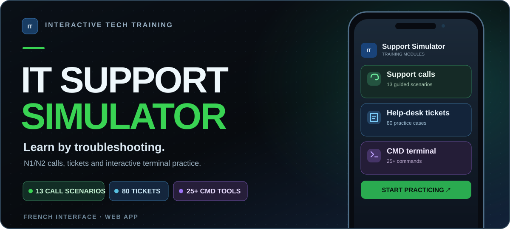

<a href="https://rogeriorch77.github.io/it-support-simulator/">
<picture>
  <source media="(max-width: 640px)" srcset="assets/itss-banner-mobile.svg" />
  
</picture>
</a>

Promotional illustration · See [real interface screenshots](https://github.com/rogeriorch77/it-support-simulator#screenshots)

**[▶ Try the live simulator](https://rogeriorch77.github.io/it-support-simulator/)** &nbsp;·&nbsp; **[View source code](https://github.com/rogeriorch77/it-support-simulator)**

---

### Learn by troubleshooting

**IT Support Simulator** is an interactive platform for French-speaking learners. Practice support calls, investigate tickets, run simulated Windows terminal commands, take timed quizzes and prepare for technical interviews.

**Built with:** HTML · CSS · JavaScript · Supabase Auth · PostgreSQL · GitHub Pages

Development status

The public demo reflects the published version. Avatar and first-visit onboarding work for v1.1 remains under development in [draft PR #2](https://github.com/rogeriorch77/it-support-simulator/pull/2).

---

<h3>HANDS-ON AREAS</h3>

  🟩 <strong>Linux &amp; server operations</strong> &nbsp;·&nbsp;
  🟦 <strong>Windows Server &amp; Active Directory</strong> &nbsp;·&nbsp;
  🟪 <strong>Networking &amp; virtualization</strong>

  🟨 <strong>Web apps &amp; databases</strong> &nbsp;·&nbsp;
  🟧 <strong>Troubleshooting &amp; testing</strong>

<h3>WORK PRINCIPLES</h3>

  <strong>Make it useful.</strong> &nbsp;·&nbsp;
  <strong>Make it testable.</strong> &nbsp;·&nbsp;
  <strong>Document what matters.</strong>

---

### Other work

**🏠 [HomeLab — Systems & infrastructure](https://github.com/rogeriorch77/homelab)**  
Proxmox VE, Debian LXC, NAS-backed backups and documentation of hands-on infrastructure exercises.

---

### Tools & practical experience

**Systems & infrastructure** · Linux · Proxmox · Docker · Nginx · Windows Server · Networking

**Field IT & networking** · Smart Hands · Rack & stack · Network equipment installation · LAN/fiber patching · Console access · SD-WAN support

**Development & tooling** · JavaScript · Go · PostgreSQL · Git · Technical documentation

---

**Built to be useful. Documented to be shared.**  
[Explore public repositories](https://github.com/rogeriorch77?tab=repositories)

