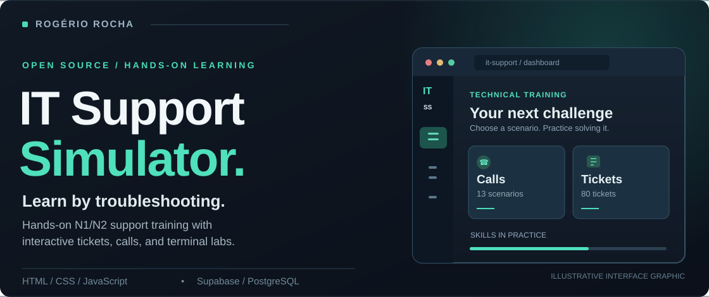

 

### [↗ Launch live demo](https://rogeriorch77.github.io/it-support-simulator/) &nbsp;·&nbsp; [View source code](https://github.com/rogeriorch77/it-support-simulator) &nbsp;·&nbsp; [Real screenshots](https://github.com/rogeriorch77/it-support-simulator#screenshots)

**13** support-call scenarios &nbsp;·&nbsp; **80** help-desk tickets &nbsp;·&nbsp; **25+** CMD commands

---

### Built to learn by doing

**IT Support Simulator** is an interactive learning platform for French-speaking N1/N2 IT support learners. It includes practical exercises you can try directly in your browser.

- **Support calls** — guided diagnostics and real-world troubleshooting decisions.
- **Tickets & terminal** — service-desk workflows and simulated Windows CMD practice.
- **Quizzes, knowledge base & interviews** — hands-on preparation and technical references.

**Stack:** HTML · CSS · JavaScript · Supabase Auth · PostgreSQL · GitHub Pages

Current development status

The published demo represents the released public version. The v1.1 avatar and first-visit onboarding work remains under development in [draft PR #2](https://github.com/rogeriorch77/it-support-simulator/pull/2). The feature graphic above is illustrative; use the real screenshots link to see the current interface.

---

### Other work

**🏠 [HomeLab — Systems & infrastructure](https://github.com/rogeriorch77/homelab)**  
Proxmox VE, Debian LXC, NAS-backed backups and documentation of hands-on infrastructure exercises.

**💬 [ZumZum — Messaging platform concept](https://github.com/rogeriorch77/zumzum)**  
Planning and documentation for a privacy-focused messaging concept. Not a deployed application.

---

### Tools & practical experience

**Systems & infrastructure** · Linux · Proxmox · Docker · Nginx · Windows Server · Networking

**Field IT & networking** · Smart Hands · Rack & stack · Network equipment installation · LAN/fiber patching · Console access · SD-WAN support

**Development & tooling** · JavaScript · Go · PostgreSQL · Git · Technical documentation

---

**Built to be useful. Documented to be shared.**  
[Explore public repositories](https://github.com/rogeriorch77?tab=repositories)

