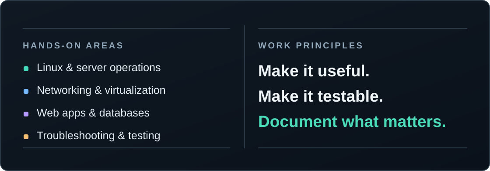

### Rogério Rocha · Practical tools, systems & software

# 🖥️ IT Support Simulator

**Hands-on IT support training for real-world N1/N2 troubleshooting.**

Official public landing-page screenshot · Interface in French 🇫🇷

 

**[▶ Try the live simulator](https://rogeriorch77.github.io/it-support-simulator/)** &nbsp;·&nbsp; **[View source code](https://github.com/rogeriorch77/it-support-simulator)** &nbsp;·&nbsp; **[Explore screenshots](https://github.com/rogeriorch77/it-support-simulator#screenshots)**

**13** support-call scenarios &nbsp;·&nbsp; **80** help-desk tickets &nbsp;·&nbsp; **25+** CMD commands

---

### Learn by troubleshooting

**IT Support Simulator** is an interactive platform for French-speaking learners. Practice support calls, investigate tickets, run simulated Windows terminal commands, take timed quizzes and prepare for technical interviews.

**Built with:** HTML · CSS · JavaScript · Supabase Auth · PostgreSQL · GitHub Pages

Development status

The public demo reflects the published version. Avatar and first-visit onboarding work for v1.1 remains under development in [draft PR #2](https://github.com/rogeriorch77/it-support-simulator/pull/2).

---

---

### Other work

**🏠 [HomeLab — Systems & infrastructure](https://github.com/rogeriorch77/homelab)**  
Proxmox VE, Debian LXC, NAS-backed backups and documentation of hands-on infrastructure exercises.

**💬 [ZumZum — Messaging platform concept](https://github.com/rogeriorch77/zumzum)**  
Planning and documentation for a privacy-focused messaging concept. Not a deployed application.

---

### Tools & practical experience

**Systems & infrastructure** · Linux · Proxmox · Docker · Nginx · Windows Server · Networking

**Field IT & networking** · Smart Hands · Rack & stack · Network equipment installation · LAN/fiber patching · Console access · SD-WAN support

**Development & tooling** · JavaScript · Go · PostgreSQL · Git · Technical documentation

---

**Built to be useful. Documented to be shared.**  
[Explore public repositories](https://github.com/rogeriorch77?tab=repositories)

